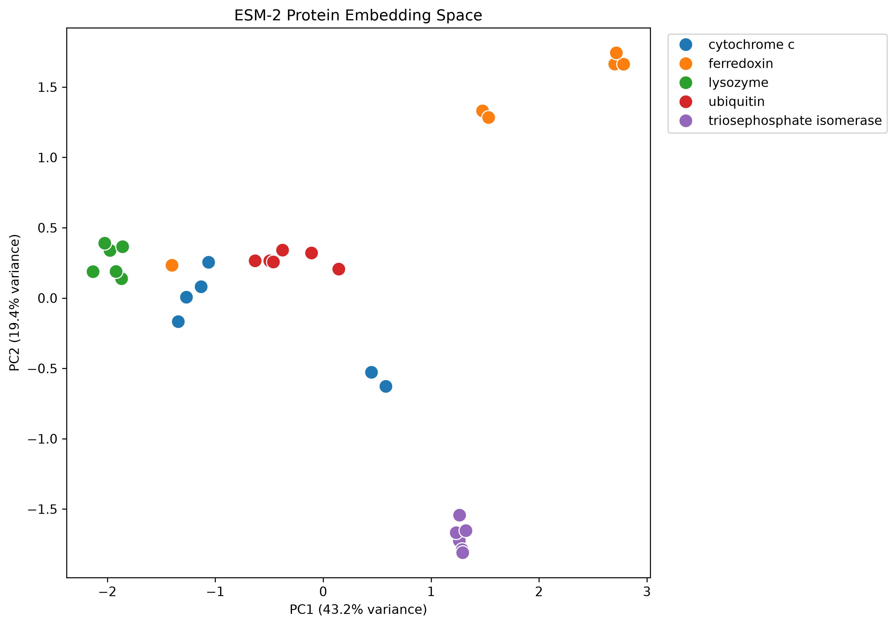
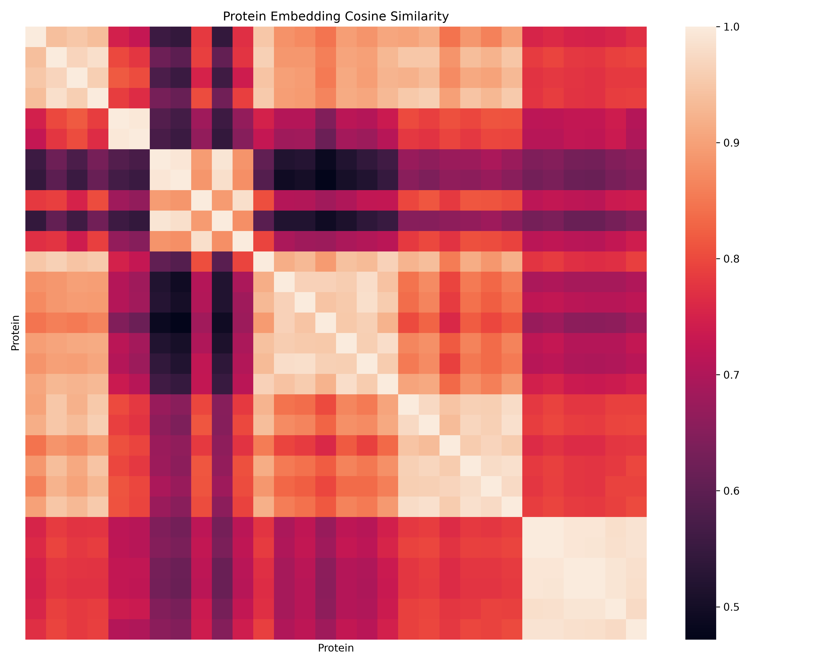

# Protein Sequence Embedding Lab

Exploring whether protein language model embeddings capture meaningful relationships between protein groups.

## Overview

This project investigates whether ESM-2 protein embeddings capture group-level structure among protein sequences.

A balanced dataset of 30 protein sequences from five protein groups was embedded using ESM-2, followed by PCA and cosine-similarity analysis.

## Results

- Proteins: **30**
- Protein groups: **5**
- Embedding dimensions: **320**
- Mean within-group similarity: **0.9241**
- Mean between-group similarity: **0.7557**
- Similarity difference: **0.1684**
- PCA variance explained by PC1 + PC2: **62.66%**

### PCA



PC1 explains 43.23% of the variance and PC2 explains 19.43%.

### Cosine Similarity



The substantially higher within-group similarity suggests that ESM-2 embeddings capture meaningful group-level structure.

## Dataset

| Protein group | Sequences |
|---|---:|
| Cytochrome c | 6 |
| Ferredoxin | 6 |
| Lysozyme | 6 |
| Ubiquitin | 6 |
| Triosephosphate isomerase | 6 |
| **Total** | **30** |

## Model

**ESM-2 8M**

`facebook/esm2_t6_8M_UR50D`

Each protein sequence was represented as a 320-dimensional embedding.

## Workflow

```text
Protein sequences
       |
       v
UniProt dataset
       |
       v
5 groups x 6 sequences
       |
       v
ESM-2
       |
       v
320D embeddings
       |
       +----------------+
       |                |
       v                v
      PCA       Cosine similarity
       |                |
       v                v
   2D plot       Similarity matrix
                        |
                        v
                Within vs between
                   comparison